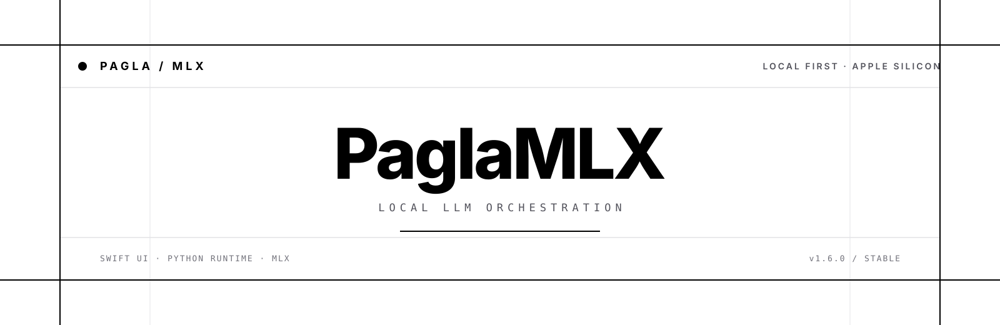

<p align="center">
  
</p>

<p align="center">
  <a href="https://www.apphole.store/PaglaAI">DOCUMENTATION</a>
  &nbsp;·&nbsp;
  <a href="https://www.apphole.store/PaglaAI/api-reference.html">API REFERENCE</a>
  &nbsp;·&nbsp;
  <a href="https://github.com/paglaai/PaglaMLX/releases">RELEASES</a>
  &nbsp;·&nbsp;
  <a href="https://github.com/paglaai/PaglaMLX/issues">ISSUES</a>
</p>

---

```text
PAGLAMLX  /  v1.6.0  /  STABLE

LOCAL ENDPOINT       127.0.0.1:2525/v1
PLATFORM             macOS 14+ · Apple Silicon
MODEL RUNTIME        mlx_lm.server
GATEWAY              FastAPI + Uvicorn
CREDENTIALS          macOS Keychain
```

## 01 / What is PaglaMLX?

PaglaMLX is a macOS menu-bar application for running and orchestrating MLX-compatible language models on Apple Silicon. It gives local models a stable API surface, manages their lifecycle, and connects them to the tools developers already use.

The current v1.6.0 release uses Swift for the macOS application and process orchestration, with Python model servers and gateway proxies managed behind the scenes.

## 02 / What does it do?

PaglaMLX turns a folder of local MLX models into one controllable inference workspace.

- Loads and unloads multiple models from the menu bar.
- Exposes OpenAI-compatible and Anthropic-compatible endpoints.
- Routes `model=auto` requests using model capability, context, and request intent.
- Dispatches cloud requests by provider prefix.
- Maintains session stickiness for consistent multi-turn behavior.
- Applies configuration for coding agents, editors, and desktop clients.
- Stores API keys and bearer tokens in macOS Keychain.
- Provides an optional cloud fallback through configured providers or OpenRouter.

## 03 / How does it do that?

The Swift application is the control plane. It runs preflight checks, resolves the Python environment, starts the gateway, launches one `mlx_lm.server` process per selected model, assigns model ports, and monitors process health.

```text
┌──────────────────────┐
│  SwiftUI menu bar    │  settings · integrations · lifecycle
└──────────┬───────────┘
           │ manages
           ▼
┌──────────────────────┐
│  Swift orchestration │  route table · preflight · processes
└──────────┬───────────┘
           │ starts / monitors
           ▼
┌──────────────────────┐       ┌──────────────────────────┐
│ FastAPI / Uvicorn    │──────▶│ mlx_lm.server            │
│ 127.0.0.1:2525/v1    │       │ one process per model    │
└──────────┬───────────┘       │ ports 50xx               │
           │                   └──────────────────────────┘
           ├──────────────▶ OpenAI / Anthropic / Gemini
           ├──────────────▶ OpenRouter / Groq / Together
           └──────────────▶ Free Router fallback
```

### Routing order

```text
01  EXACT LOCAL MATCH       model name matches a loaded route
02  AUTO-ROUTER             capability + context + request intent
03  CLOUD PREFIX            provider-specific model prefixes
04  FREE ROUTER             optional OpenRouter fallback
05  SESSION STICKINESS      reuse the session's selected backend
06  LOCAL FALLBACK          first available local model
07  HTTP 503                no usable route exists
```

| Prefix | Provider |
|---|---|
| `gpt-`, `o1`, `o3` | OpenAI |
| `claude-` | Anthropic |
| `gemini-` | Gemini |
| `openrouter/` | OpenRouter |
| `groq/` | Groq |
| `together/` | Together AI |

## 04 / Why is it better or different?

PaglaMLX is designed around control, compatibility, and low-friction local inference rather than a single model or single client.

| Difference | Why it matters |
|---|---|
| Menu-bar control | Start, stop, inspect, and route models without maintaining terminal sessions. |
| One stable endpoint | Clients do not need to know which model process or port is active. |
| Dual protocol support | OpenAI-native and Anthropic-native tools can share the same local gateway. |
| Local-first routing | Requests can stay on-device, with cloud fallback available when explicitly configured. |
| Model concurrency | Multiple model processes can remain available and be selected by route. |
| Keychain credentials | Provider keys and bearer tokens are not kept in plain-text preferences. |
| Integration actions | Common client configuration can be applied from one settings panel. |
| Apple Silicon focus | The workflow is tuned for MLX models and macOS hardware. |

A future native Swift + MLX C++ FFI runtime is documented in the [architecture reference](docs/architecture.md) and tracked in the [roadmap](ROADMAP.md). That migration is not yet the shipped v1.6.0 runtime.

## 05 / Recommended best-case usages

PaglaMLX is best suited to developers and small teams who want local models available through familiar APIs.

- **Private coding assistance:** connect Claude Desktop, Claude Code, Continue.dev, Cline, or VS Code to models running on your Mac.
- **Model comparison:** keep several MLX models loaded and route requests by model name or `auto`.
- **Offline prototyping:** develop against an OpenAI-compatible endpoint without sending every prompt to a hosted provider.
- **Hybrid workflows:** keep routine or sensitive requests local and use provider prefixes for tasks that need cloud capacity.
- **Client integration testing:** exercise OpenAI- or Anthropic-shaped clients against a controllable local endpoint.
- **Apple Silicon experimentation:** test quantized MLX models while monitoring process and memory behavior from the menu bar.

PaglaMLX is not intended to replace a hardened multi-tenant production inference platform, public API gateway, or distributed serving cluster.

## 06 / How is it built?

PaglaMLX is a Swift Package Manager project with a native macOS UI and Swift-owned process orchestration. The current runtime boundary is explicit:

- **SwiftUI / AppKit:** menu-bar interface, settings, integrations, preflight, and lifecycle.
- **Swift orchestration:** Python discovery, process startup, route registration, health monitoring, and shutdown.
- **FastAPI / Uvicorn:** local OpenAI-compatible gateway and Anthropic translation proxy.
- **`mlx_lm.server`:** one Python model-serving process per selected MLX model.
- **macOS Keychain Services:** secure provider-key and bearer-token storage.
- **Swift Package Manager:** source builds and release packaging.

### Requirements

| Requirement | Version / value |
|---|---|
| Operating system | macOS 14.0+ |
| Hardware | Apple Silicon: M1, M2, M3, or M4 |
| Python | 3.12+ |
| Model serving | `mlx-lm` |
| Gateway packages | `fastapi`, `uvicorn`, `httpx` |

## 07 / How do I use it?

### Install the app

Download the latest `.dmg` from [GitHub Releases](https://github.com/paglaai/PaglaMLX/releases), open it, and drag `PaglaMLX.app` to `Applications`.

Install the current Python runtime dependencies before launching:

```bash
pip3 install mlx-lm fastapi uvicorn httpx
```

### Build from source

```bash
git clone https://github.com/paglaai/PaglaMLX.git
cd PaglaMLX
./build_dmg.sh
```

Or build the Swift package directly:

```bash
swift build -c release
```

### First run

1. Open **Settings → App** and choose the directory containing your MLX model folders.
2. Open **Settings → Python** and confirm the Python 3.12+ executable.
3. Run preflight and resolve missing package or permission warnings.
4. Choose a model from the menu-bar picker and press **Play**.
5. Connect a client to `http://127.0.0.1:2525/v1`.

A model directory typically looks like this:

```text
~/Models/mlx/
├── Llama-3.2-3B-Instruct-4bit/
│   ├── config.json
│   ├── tokenizer.json
│   └── *.safetensors
├── Mistral-7B-Instruct-4bit/
│   └── ...
└── Qwen2.5-Coder-7B-4bit/
    └── ...
```

### Send a request

```bash
curl http://127.0.0.1:2525/v1/chat/completions \
  -H "Authorization: Bearer <your-key>" \
  -H "Content-Type: application/json" \
  -d '{
    "model": "auto",
    "messages": [
      {"role": "user", "content": "Hello from PaglaMLX."}
    ]
  }'
```

For Anthropic-native clients, use `POST /v1/messages`. The local bearer token is configured in **Settings → Network** and stored in Keychain. Do not retrieve secrets with `defaults read` or commit them to configuration files.

### Apply an integration

Open **Settings → Integrations**, select a client, review the target configuration, and choose **Apply**. PaglaMLX can configure common tools including VS Code, Continue.dev, Claude Desktop, Claude Code, OpenCode, Codex CLI, Cline, and Qwen Code.

## 08 / Documentation and support

| Resource | Link |
|---|---|
| Documentation | [apphole.store/PaglaAI](https://www.apphole.store/PaglaAI) |
| API reference | [API reference](https://www.apphole.store/PaglaAI/api-reference.html) |
| Architecture | [Runtime architecture](docs/architecture.md) |
| Roadmap | [ROADMAP.md](ROADMAP.md) |
| Security | [SECURITY.md](SECURITY.md) |
| Releases | [GitHub Releases](https://github.com/paglaai/PaglaMLX/releases) |
| Support and issues | [GitHub Issues](https://github.com/paglaai/PaglaMLX/issues) |
| Contact | [PaglaMLX@apphole.store](mailto:PaglaMLX@apphole.store) |

## 09 / Security baseline

- Bind locally to `127.0.0.1` by default.
- Keep API keys and bearer tokens in macOS Keychain.
- Migrate legacy `UserDefaults` credentials with write-before-delete safety.
- Do not log prompts, generated content, provider responses, or credentials.
- Treat non-loopback binding and public tunnels as explicit security decisions.

Read [SECURITY.md](SECURITY.md) before reporting a vulnerability.

## 10 / License and attribution

**License:** MIT — see [LICENSE](LICENSE).

**PaglaAI © 2026 | An Aynaghor Local AI Intelligent Initiative**

**Contact:** [PaglaMLX@apphole.store](mailto:PaglaMLX@apphole.store)

The repository banner uses Pagla Sans from [PaglaDESIGN](https://github.com/paglaai/PaglaDESIGN/tree/main/fonts). Font redistribution terms are included in [`fonts/LICENSE.txt`](fonts/LICENSE.txt).

---

<p align="center">
  <sub>PAGLA / MLX &nbsp;·&nbsp; LOCAL FIRST &nbsp;·&nbsp; APPLE SILICON &nbsp;·&nbsp; PAGLA DESIGN</sub>
</p>
